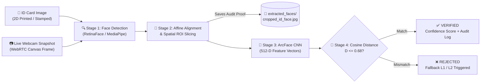

<div align="center">

# 🛡️ Cross-Domain Biometric Identity & Document Verification Engine

**An End-to-End Computer Vision Pipeline for 1:1 Unconstrained Facial Verification, Spatial ROI Extraction, and Automated e-KYC Auditing**

[](https://python.org)
[](https://fastapi.tiangolo.com)
[](https://react.dev)
[](https://opencv.org)
[](https://github.com/serengil/deepface)
[](https://streamlit.io)

</div>

---

## 📌 Overview

**VeriFace-CV** solves a challenging real-world **Cross-Domain Computer Vision** problem: verifying a person's identity by matching a **low-resolution, aged, or ink-stamped physical ID card photograph** against a **live, unconstrained webcam frame** in real time.

Traditional manual counter verification suffers from human fatigue, lookalike spoofing, obscured facial features from official stamps, and zero digital audit trails. **VeriFace-CV** replaces subjective human guessing with a **4-stage modular Computer Vision pipeline** that localizes facial landmarks, performs affine geometric alignment, archives the cropped ID facial Region of Interest (ROI), and computes 512-dimensional craniofacial embeddings in **ArcFace** hypersphere space.

---

## ✨ Key Computer Vision & System Features

* 🎯 **Spatial Face Localization & Landmark Detection:** Utilizes **RetinaFace / MediaPipe** detectors to isolate facial bounding boxes $[x, y, w, h]$ and 5-point landmarks from cluttered document backgrounds, ignoring text, holograms, and overlapping ink stamps.
* 📐 **Affine Geometric Alignment & Automated ROI Slicing:** Rotates and normalizes detected faces based on inter-ocular angles and automatically slices the facial sub-matrix (`extracted_faces/cropped_id_face.jpg`) to create an immutable digital audit trail.
* 🧠 **512-D Deep Metric Learning (ArcFace):** Maps aligned $112 \times 112 \times 3$ RGB facial tensors into a 512-dimensional hypersphere using Additive Angular Margin Loss, ensuring resilience against age gaps, lighting variations, and headwear/caps.
* 📸 **Interactive Live Camera Popup UI:** Modern light-themed **React + Vite** web console featuring a dedicated WebRTC camera capture modal, real-time confidence scoring, and multi-tier fallback guidance.
* ⚡ **Triple Execution Modes:** Run as a full-stack **React + FastAPI** web application, an interactive **Streamlit** dashboard, or a standalone **Local Python CLI** benchmark.

---

## 🏗️ System Architecture & CV Pipeline



### Multi-Tier Fallback Logic
1. **Fallback Level 1 (Environmental / Image Quality Issue):** Prompts the user to adjust room lighting, eliminate glare, or re-capture a sharper image if face detection or landmark confidence is low.
2. **Fallback Level 2 (Biometric Mismatch / Spoof Alert):** Immediately halts automated onboarding when Cosine Distance exceeds the security threshold ($\tau = 0.68$) and flags the session for physical counter verification.

---

## 📂 Project Directory Structure

```text
├── frontend/                   # React + Vite Web Console
│   ├── public/                 # Static assets & branding icons
│   ├── src/
│   │   ├── App.jsx             # Main KYC UI, Camera Popup Modal & Evaluation Dashboard
│   │   ├── App.css             # Component styling
│   │   ├── index.css           # Global styles
│   │   └── main.jsx            # React DOM entrypoint
│   ├── index.html
│   ├── package.json
│   └── vite.config.js
├── extracted_faces/            # Auto-generated cropped ID card faces (Audit Trail)
│   └── .gitkeep
├── img/                        # Local test dataset directory (excluded from Git for privacy)
│   └── .gitkeep
├── main.py                     # FastAPI Backend Server (/verify endpoint + CV pipeline)
├── app.py                      # Streamlit Web Console (Alternative rapid UI)
├── verify_v1.py                # Baseline 1:1 local Python verification script
├── verify_v2.py                # Enhanced detector & occlusion-resilient CLI script
├── .gitignore
└── README.md
```

---

## ⚙️ Installation & Prerequisites

### 1. Clone the Repository
```bash
git clone [https://github.com/YOUR_USERNAME/YOUR_REPO_NAME.git](https://github.com/YOUR_USERNAME/YOUR_REPO_NAME.git)
cd YOUR_REPO_NAME
```

### 2. Backend Python Dependencies
Ensure you have **Python 3.10+** installed. Create a virtual environment and install the required CV and API packages:
```bash
python3 -m venv venv
source venv/bin/activate  # On Windows: venv\Scripts\activate

pip install fastapi uvicorn python-multipart opencv-python deepface tf-keras mediapipe retina-face streamlit pillow numpy
```

### 3. Frontend Node Dependencies
Ensure you have **Node.js (v18+)** and `npm` installed:
```bash
cd frontend
npm install
cd ..
```

---

## 🚀 How to Run the Project (3 Modes)

### Mode 1: Full-Stack React Web Console + FastAPI Backend (Recommended)
Run this mode using **two separate terminals**:

**Terminal 1 — Start the FastAPI Vision Backend:**
```bash
python3 -m uvicorn main:app --reload --port 8000
```
*The backend API will be live at `http://localhost:8000` (Swagger docs at `http://localhost:8000/docs`).*

**Terminal 2 — Start the React Frontend:**
```bash
cd frontend
npm run dev
```
*Open **`http://localhost:5173`** in your browser. Upload an ID card, click the capture button to trigger the live camera popup, and run verification.*

---

### Mode 2: Streamlit Interactive Console
To launch the standalone Streamlit web interface:
```bash
python3 -m streamlit run app.py
```
*Open **`http://localhost:8501`** in your browser.*

---

### Mode 3: Local Python CLI Verification (`verify_v1.py` / `verify_v2.py`)
> ⚠️ **Important Note for Local CLI Testing:**  
> For privacy and repository hygiene, personal test images inside the `img/` folder are excluded via `.gitignore`. Before running `verify_v1.py` or `verify_v2.py`, place your test ID image and live photo inside the `img/` directory (or project root as configured in the script):
> * Example ID Image: `img/4.png` or `img/id_card.jpg`
> * Example Live Image: `img/chetan_live.jpg` or `img/2.jpg`

Run the local verification script:
```bash
python3 verify_v1.py
# Or run the enhanced v2 script:
python3 verify_v2.py
```
*The cropped ID face will automatically be saved inside `extracted_faces/cropped_id_face.jpg`.*

---

## 🔬 Technical Specifications

| Component | Technology / Model Used | Purpose |
| :--- | :--- | :--- |
| **Face Detection & Landmarks** | `RetinaFace` / `MediaPipe` / `OpenCV` | 2D bounding-box regression & 5-point facial keypoint extraction |
| **Geometric Normalization** | OpenCV Affine Transformation & Slicing | Eye-level horizontal alignment & ROI extraction (`cropped_id_face.jpg`) |
| **Feature Descriptor** | `ArcFace` (ResNet-100 Backbone) | 512-dimensional facial feature vector embedding |
| **Similarity Metric** | Cosine Distance ($1 - \cos\theta$) | Angular distance calculation in 512-D hypersphere ($\tau = 0.68$) |
| **Backend API** | FastAPI + Uvicorn | Asynchronous REST endpoint (`POST /verify`) |
| **Frontend UI** | React 19 + Vite + WebRTC Canvas | Document upload, popup webcam capture & real-time telemetry |

---

<div align="center">
  <b>Developed by Chetan Lohia</b><br/>
  <i>B.Tech Computer Science & Engineering (AI & ML)</i>
</div>
